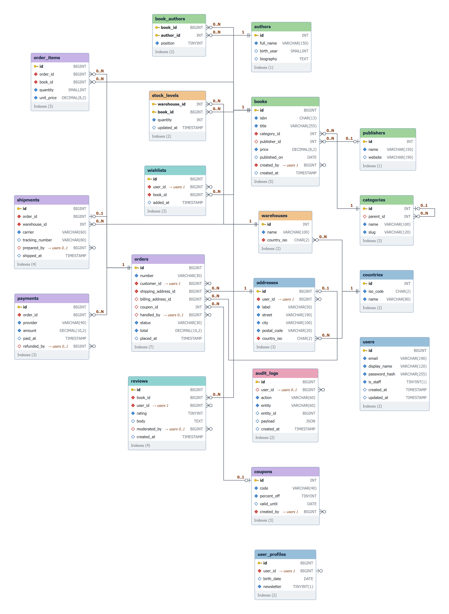

# dbschema

Skill [Claude Code](https://docs.claude.com/en/docs/claude-code) qui dessine le schéma d'une base MySQL ou MariaDB dans le style de MySQL Workbench, mais avec une vraie mise en page :
- les tables sont séparées ;
- les liens sont orthogonaux, partent de la colonne FK et arrivent sur la colonne référencée ;
- les cardinalités sont en pattes d'oie avec leur texte (`1`, `0..1`, `0..N`, `1..N`) ;
- aucun chevauchement : c'est vérifié avant chaque livraison.



Exemple interactif : [`examples/librairie.html`](examples/librairie.html) (à télécharger et ouvrir localement).

## Ce que ça produit

| Fichier | Contenu |
|---|---|
| `<NOM>.html` | Page autonome, sans ressource externe. Vues : toutes les colonnes, clés seules, noms seuls, liens complets vers les tables très référencées, cadres par domaine. Zoom, déplacement, recherche, surbrillance au survol, panneau de détail (colonnes, index, FK), légende des domaines, thème clair ou sombre, export PNG. |
| `<NOM>.png` | Vue complète en double résolution. |
| `<NOM>.sql` | `mysqldump --no-data` de la structure, donc un SQL déjà exécuté une fois. |
| `<NOM>_workbench_layout.py` | Script à lancer dans MySQL Workbench (*Scripting > Run Workbench Script File...*) pour placer les tables d'un diagramme existant. |
| `<NOM>_layout.mwb` | Avec `--mwb modele.mwb` : copie du modèle Workbench avec les tables placées. La source n'est pas modifiée. |

Sources acceptées :
- un script SQL (`--sql`) ;
- les migrations d'un projet Laravel (`--laravel`) ;
- une base MySQL ou MariaDB existante, en lecture seule (`--db`), éventuellement distante. C'est la voie pour tous les autres frameworks : voir [Autres frameworks](#autres-frameworks).

## Installation

Prérequis :
- Node 18 ou plus ;
- Python 3.9 ou plus (`python3` ou `python`) ;
- un serveur MySQL ou MariaDB (voir [Compatibilité](#compatibilité)), local pour `--sql` et `--laravel`, avec ses clients `mysql` et `mysqldump` (ou `mariadb` et `mariadb-dump`) ;
- Chrome, Edge ou Chromium, pour le PNG et la mesure des textes (sans navigateur : HTML et SQL seulement) ;
- bash : sous Windows, celui de Git for Windows ;
- Playwright pour Python, seulement pour les tests d'interface.

```bash
git clone https://github.com/Grozef/dbschema.git ~/.claude/skills/dbschema
cd ~/.claude/skills/dbschema && npm ci --ignore-scripts
```

Variables d'environnement facultatives :

| Variable | Rôle | Défaut |
|---|---|---|
| `DBSCHEMA_MYSQL_BIN` | Dossier qui contient `mysql` ou `mariadb` | l'unique installation Laragon, XAMPP, WAMP ou MAMP trouvée, sinon le `PATH` |
| `DBSCHEMA_MYSQL_HOST` | Hôte du serveur (TCP) | `127.0.0.1` |
| `DBSCHEMA_MYSQL_PORT` | Port du serveur | `3306` |
| `DBSCHEMA_MYSQL_USER` | Utilisateur | `root` |
| `DBSCHEMA_MYSQL_PASSWORD` | Mot de passe | aucun |
| `DBSCHEMA_CHROME` | Chemin du navigateur (`none` : aucun, HTML et SQL seulement) | Chrome, Edge ou Chromium détecté |

### Selon votre installation

| Installation | Réglage |
|---|---|
| Laragon, XAMPP, WAMP, MAMP | Aucun si une seule version de MySQL ou MariaDB est installée. Sinon : `DBSCHEMA_MYSQL_BIN` vers le dossier `bin` voulu (ex. `C:\wamp64\bin\mariadb\mariadb11.4.4\bin`). Port ou mot de passe différents (MAMP par exemple) : `DBSCHEMA_MYSQL_PORT`, `DBSCHEMA_MYSQL_PASSWORD`. |
| Linux (apt, dnf), macOS (Homebrew) | Clients dans le `PATH`. Le `root` de MySQL ou MariaDB installé par paquet se connecte souvent par socket seulement : créer un utilisateur avec mot de passe, puis `DBSCHEMA_MYSQL_USER` et `DBSCHEMA_MYSQL_PASSWORD`. |
| Docker | Publier le port sur la machine (`-p 127.0.0.1:3307:3306`), puis `DBSCHEMA_MYSQL_PORT=3307` et `DBSCHEMA_MYSQL_PASSWORD`. Les clients `mysql` et `mysqldump` doivent être installés sur la machine. |
| Serveur distant | `--db` seulement (lecture seule), avec `DBSCHEMA_MYSQL_HOST`. `--sql` et `--laravel` sont refusés : ils créeraient une base et un compte sur ce serveur. Le contrôle porte sur `DBSCHEMA_MYSQL_HOST` : un tunnel (SSH, `port-forward`) vers un serveur distant sur `127.0.0.1` n'est pas détecté, ne l'utilisez pas avec `--sql`. |

La connexion se fait toujours en TCP : un `localhost` ne passe pas par le socket.

### Compatibilité

Ce que la suite de tests prouve (`tests/compat_test.py`, conteneurs Docker jetables) :

| Serveur | Client | Système | Résultat |
|---|---|---|---|
| MySQL 8.4 (Laragon) | MySQL 8.4 | Windows 11 | suite complète |
| MySQL 8.4, MySQL 5.7, MariaDB 11.4 (Docker) | MySQL 8.4 | Windows 11 | suite complète |
| MariaDB 11.4 (Docker) | MariaDB (Debian 12) | Linux, sans navigateur | HTML, SQL, 5 vues contrôlées, sans PNG |

XAMPP, WAMP et MAMP ne sont pas testés sur une vraie installation : seule la recherche de leurs binaires l'est, sur une arborescence factice. macOS n'est pas testé.

## Utilisation

Dans Claude Code : `/dbschema mon_schema.sql`, ou une demande comme « dessine le schéma de la base ». En ligne de commande :

```bash
bash ~/.claude/skills/dbschema/dbschema.sh all --sql schema.sql --out sortie --name MON_SCHEMA \
  [--groups domaines.json] [--cards cardinalites.json] [--frames] [--hub 8|off] [--title "..."] [--mwb modele.mwb]
# autres sources : --db ma_base, ou --laravel chemin/du/depot --trust-repo [--keep-framework]
```

Options :
- `--groups` : `{"DOMAINE": ["table", ...]}`. Chaque domaine a sa couleur et apparaît dans la légende ; `--frames` ajoute une vue où chaque domaine est encadré.
- `--cards` : cardinalités que le schéma ne peut pas exprimer, par exemple `{"orders.customer_id": {"child": "1..N"}}`.
- `--hub K` : une table référencée par plus de K clés étrangères (8 par défaut) a ses liens dessinés en amorces étiquetées (`→ users`). C'est l'équivalent du *split* de Workbench.

## Autres frameworks

Pour Symfony, Django, Rails, Prisma ou tout autre outil de migrations, lancez vos migrations sur votre base de développement comme d'habitude, puis lisez-la avec `--db`. Le skill n'exécute alors aucun code du projet.

| Framework | Migrations |
|---|---|
| Symfony / Doctrine | `php bin/console doctrine:migrations:migrate` |
| Django | `python manage.py migrate` |
| Ruby on Rails | `bin/rails db:migrate` |
| Prisma | `npx prisma migrate deploy` |
| Laravel (sans `--trust-repo`) | `php artisan migrate` |

```bash
bash ~/.claude/skills/dbschema/dbschema.sh all --db ma_base_dev --out sortie --name MON_SCHEMA
```

Les tables techniques du framework (`doctrine_migration_versions`, `django_migrations`, `schema_migrations`, `_prisma_migrations`...) apparaissent alors dans le schéma. Autre voie : un export de structure (phpMyAdmin, Adminer, `mysqldump --no-data`) passé à `--sql`. Les tests le vérifient sur un export type de chaque outil (`tests/fixtures/phpmyadmin.sql`, `adminer.sql`), pas sur toutes leurs versions ; un fichier enregistré en UTF-8 avec BOM est accepté.

## Sécurité

**`--laravel` exécute le code PHP du dépôt** (bootstrap, service providers, migrations) avec vos droits : ne l'utilisez que sur un dépôt de confiance. Le skill refuse sans `--trust-repo`. Le code reçoit un environnement réduit (sans mot de passe ni jeton de votre session), mais ce n'est pas une barrière : il tourne sous votre compte et peut lire ce que vous pouvez lire.

**Les livrables décrivent votre base** : structure complète, commentaires, valeurs par défaut et ENUM, noms d'index et de contraintes. Relisez-les avant de les publier. Le SQL exporté ne contient que les tables : ni vues, ni triggers, ni routines, ni compteurs `AUTO_INCREMENT=N`. Un script `--sql` qui crée autre chose que des tables est refusé.

`--sql` et `--laravel` exécutent du code fourni par l'utilisateur. Garde-fous :
- **Base et utilisateur jetables.** Le script s'exécute dans une base `zz_dbschema_<horodatage>`, avec un utilisateur MySQL du même nom qui n'a de droits que sur cette base. Les deux sont supprimés à la fin, même en cas d'erreur ; si le processus est tué, au lancement suivant (après une heure).
- **Filtre avant exécution.** Un premier filtre refuse, avec un message lisible : `USE`, `CREATE/DROP DATABASE`, les noms `base.table`, `SET GLOBAL`, les modes SQL qui changent la lecture des chaînes, les commandes du client `mysql`, et les tables qui lisent ou écrivent hors de la base (`ENGINE=FEDERATED`, `CONNECT`, `SPIDER`, y compris écrits entre guillemets ou backticks, `CONNECTION`, `DATA DIRECTORY`). Le client tourne en `--binary-mode`.
- **Laravel.** `DB_URL` est neutralisé. La configuration effective est lue avant `migrate`, et les migrations qui changent de connexion sont refusées.
- **Identifiants.** Ils passent par un fichier d'options temporaire, jamais par la ligne de commande. Le `my.ini` du serveur est ignoré et `local-infile` est désactivé.
- **Noms piégés.** Un nom de table, de colonne ou de vue qui contient un caractère de contrôle est refusé : il pourrait injecter du code dans le script Workbench généré, ou faire passer une vue dans le SQL exporté.
- **Relevé avant/après.** Les tables des autres bases sont relevées avant et après : une table créée, supprimée ou recréée ailleurs arrête tout (code 3). Une écriture de données ailleurs est signalée par un avertissement sans bloquer : c'est normal si une autre application du poste écrit à ce moment ; sinon, ne pas utiliser le résultat.
- **Page HTML.** Sa politique de sécurité (CSP) n'autorise qu'un script, désigné par son empreinte SHA-256 (`assets/viewer.js`), et aucune connexion : un script injecté par un nom de table ne s'exécuterait pas.

Limites : voir la section *Limites connues* de [`SKILL.md`](SKILL.md).

## Mise en page et contrôles

La mise en page utilise [elkjs](https://github.com/kieler/elkjs) (algorithme *layered*, routage orthogonal) en deux passes, avec des ports fixés sur les lignes de colonnes. Plusieurs FK vers une même colonne arrivent sur un port commun.

Chaque vue passe des contrôles bloquants avant d'être livrée :
- aucune table ne se superpose à une autre ;
- aucun lien ne traverse une table, et deux liens ne se superposent pas ;
- aucune étiquette n'est masquée ;
- chaque lien est accroché à la bonne colonne, à ses deux extrémités ;
- chaque relation est dessinée, avec ses cardinalités ;
- aucun texte ne déborde de sa carte (mesuré dans Chrome).

## Tests

```bash
pip install -r requirements-dev.txt          # pytest, Playwright (tests seulement)
bash dbschema.sh test                        # node:test (tests/js) puis pytest (tests/)
bash dbschema.sh test -m unit                # sans base ni navigateur
bash dbschema.sh test -m "not perf"          # tout sauf les budgets de performance
python tests/compat_test.py <dossier_temp>   # Docker : MariaDB 11.4, MySQL 5.7, MySQL 8.4, Linux
# couverture de lib/ : Python (sous-processus compris) puis JS
DBSCHEMA_COV=1 python -m pytest -m "not perf" --cov --cov-config=.coveragerc --cov-report=term-missing
node --test --experimental-test-coverage --test-coverage-include='lib/**' tests/js/*.test.mjs
```

Chaque test a un délai de 10 minutes (`pytest-timeout`) et chaque job de CI un délai de 15 minutes (30 pour CodeQL) : un test figé échoue au lieu de bloquer.

| Dossier | Marqueur | Contenu |
|---|---|---|
| `tests/js/` | `node:test` | mise en page, contrôles (avec des mutations qui doivent les faire échouer), échappement du SVG et du HTML |
| `tests/unit/` | `unit` | filtre SQL, binaires et connexion, modèle et cardinalités sur des données injectées, `--cards`, Laravel, Workbench et `.mwb` |
| `tests/functional/` | `functional` | extraction sur un vrai serveur, modèle identique quel que soit le serveur, aller-retour SQL, `--db` en lecture seule |
| `tests/e2e/` | `e2e` | `dbschema.sh all` de bout en bout, PNG, script Workbench, `.mwb`, interface sous Playwright, débordements, mode sans navigateur |
| `tests/perf/` | `perf` | schémas générés de 25, 100 et 250 tables, budgets de temps et de taille (`budgets.json`) bloquants en CI Linux ; ailleurs, mesures affichées sans budget |
| `tests/security/` | `security` | utilisateur jetable contre une base témoin, constats des audits, fuzz du filtre (2 000 scripts), XSS dans le navigateur, arguments piégés |

Sans serveur ou sans navigateur, les tests qui en dépendent sont sautés, et pytest le signale. En CI, `DBSCHEMA_REQUIRE_DB=1` et `DBSCHEMA_REQUIRE_BROWSER=1` en font des échecs. Les tests créent et suppriment des bases et des comptes `zz_dbschema_*` : à lancer sur un serveur de développement.

### Intégration continue

GitHub Actions (`.github/workflows/`), à chaque push sur `dev` ou `main` et à chaque PR vers `main` :
- `static` ;
- `unit` : Linux, Windows et macOS, Python 3.9 et 3.13, Node 18 et 24 ; couverture JS de `lib/` (seuils : lignes 95 %, branches 85 %, fonctions 95 %) ;
- `db` : MySQL 8.4, MySQL 5.7 et MariaDB 11.4, toute la suite hors perf ; couverture Python de `lib/` (seuil 90 %) ;
- `render` : PNG sous Windows et macOS ;
- `perf` ;
- `security` : Bandit, `npm audit`, gitleaks ;
- `codeql` ;
- sur les PR seulement, `dependency-review`.


## Licence

MIT, voir [`LICENSE`](LICENSE). elkjs, installé par `npm ci`, est distribué sous EPL-2.0. Ce projet n'est affilié ni à Oracle ni à MySQL Workbench.
